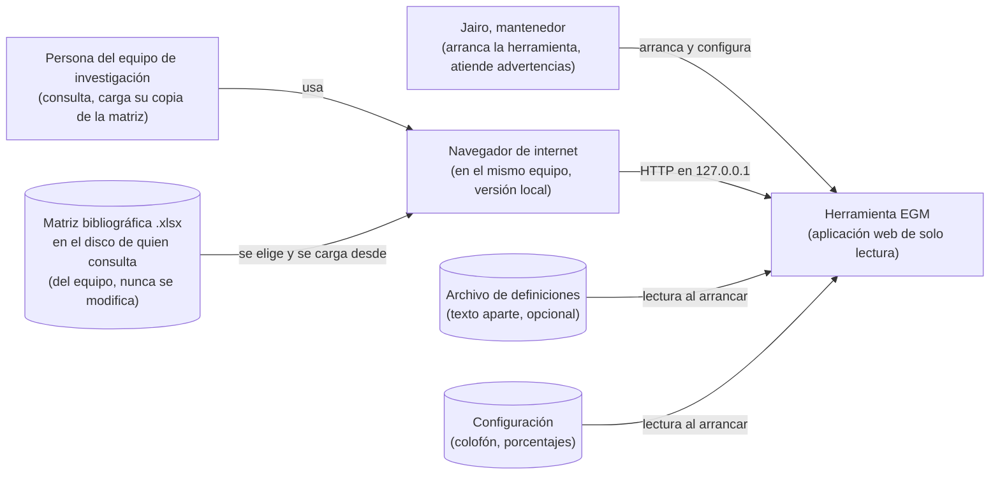
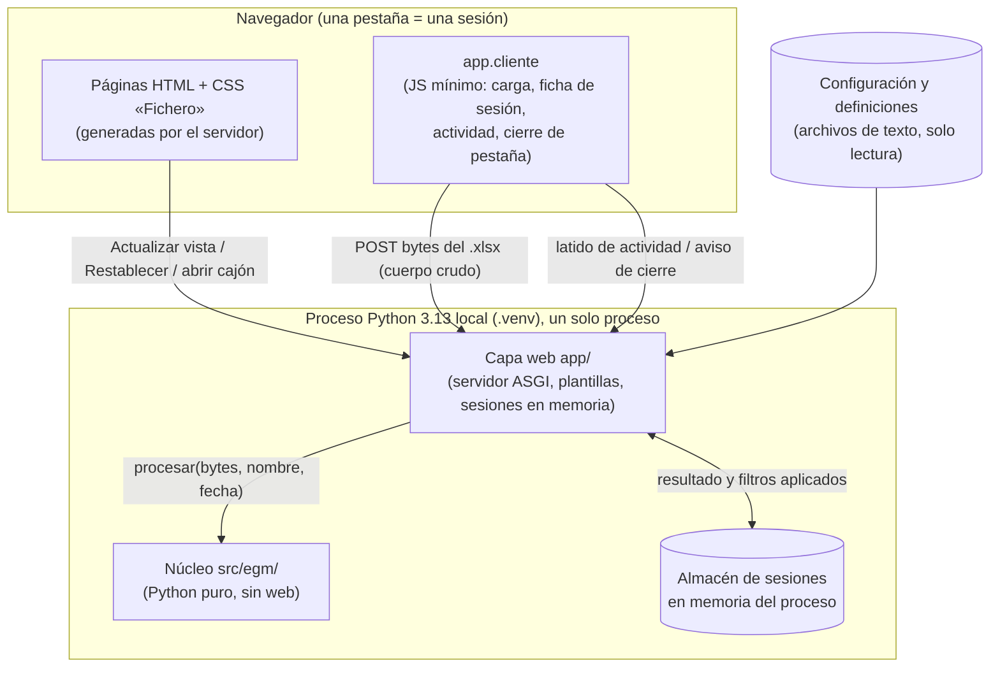
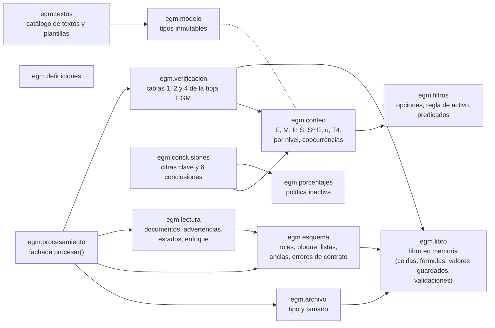
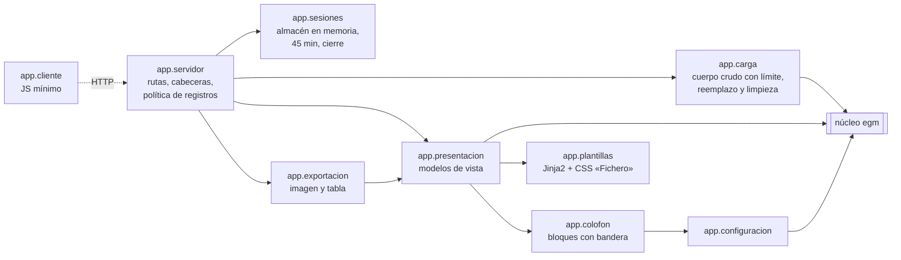
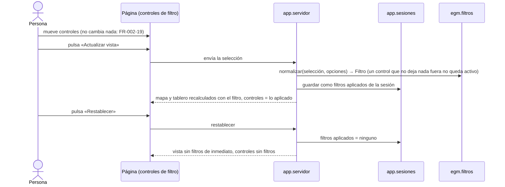

# Arquitectura de la herramienta EGM · Medios de vida

**Fecha**: 2026-11-21 · **Estado**: aprobada por Jairo el 2026-11-22 (COR-011 y COR-012 verificadas)
**Autor**: `arquitecto`
**Entradas**: `docs/specs/000-vision-alcance.md`, `contrato-datos.md`, specs 001 a 003 (v0, aprobados por Jairo el
21-nov-2026), `docs/fuentes/`, skills `contrato-matriz` y `sistema-diseno-egm`, decisiones de Jairo del 21-nov-2026
(`.claude/skills/analisis-impacto/references/invariantes.md`, secciones «Decisiones del 21-nov-2026»).
**Decisiones**: ADR-001 a ADR-005 en `docs/arquitectura/adr/`. Todas en estado «aceptado» desde el 21-nov-2026
[Fuente: decisión de Jairo, 21-nov-2026]. Solo queda abierta, a propósito, NC-ADR004-1 (despliegue posterior a la
demostración), como decisión futura del equipo.

Este documento es interno (para Jairo y los subagentes). No es texto de interfaz.

---

## 1. Principios que ordenan la arquitectura

| Principio | Requisitos que lo motivan |
|---|---|
| **P1. Núcleo sin web.** Todo el cálculo (lectura, validación, conteo, filtros, verificación, cifras y conclusiones) vive en `src/egm/` y no importa nada de `app/` ni de bibliotecas web. | NFR-000-14, SC-000-14 |
| **P2. La fila es la fuente de verdad.** Todo número se construye como la longitud de una lista de filas; el número no existe sin su lista. | NFR-000-02, FR-001-11, SC-002-01, SC-003-01 (ADR-001) |
| **P3. La herramienta se adapta al archivo.** Roles por encabezado, categorías desde las validaciones, ningún nombre de categoría escrito en el código (salvo los tres valores ancla del contrato §4.1). | NFR-000-06, FR-001-01, FR-001-05, SC-001-05 |
| **P4. Solo memoria, solo sesión.** El archivo y su contenido viven en la memoria del proceso, atados a una sesión de una pestaña; nada se escribe en disco ni en registros. | NFR-000-17, NFR-000-18, NFR-000-01 (ADR-003, ADR-004) |
| **P5. Determinismo.** Mismas entradas (bytes, nombre, fecha) ⇒ mismas salidas. La fecha de lectura se inyecta; ningún resultado depende del orden de un conjunto. | NFR-000-09, SC-000-09 |
| **P6. Textos en un solo lugar.** Todo texto dirigido al equipo sale de un catálogo único y revisable. | NFR-000-03, NFR-000-08, FR-003-12, SC-000-03 |
| **P7. HTML y CSS propios.** El servidor produce HTML semántico con plantillas propias y una hoja de estilo propia («Fichero»); el JavaScript es mínimo y no dibuja datos. | NFR-000-04, NFR-000-05, NFR-000-10, NFR-000-13 (ADR-003) |

---

## 2. Contexto



- La matriz llega **solo** por carga desde el navegador (FR-001-20). La herramienta no lee `data/raw/`: esa carpeta es
  del proyecto (pruebas y control de huella, apéndice A del contrato).
- La versión de esta entrega es **local**: la herramienta y el navegador corren en el mismo equipo (restricción 5 de
  `000`, SC-000-15). El despliegue posterior lo decide el equipo (ADR-004).
- Fuera del sistema: vista de red y módulo no supervisado (puntos de extensión, §7).

---

## 3. Contenedores



| Contenedor | Tecnología (ADR-003) | Responsabilidad | Requisitos |
|---|---|---|---|
| Núcleo `src/egm/` | Python 3.13; lectura del libro con `openpyxl` en memoria | Todo el cálculo y los textos | NFR-000-14, todos los FR-001 de cálculo, FR-002 y FR-003 de datos |
| Capa web `app/` | FastAPI (Starlette) + Jinja2 + Uvicorn, un solo proceso | Rutas, sesiones, carga, presentación, plantillas, exportación, colofón | NFR-000-15, NFR-000-17, NFR-000-18, FR-001-20, FR-002-15 |
| Cliente | HTML/CSS propios, htmx y un guion propio pequeño, todo servido localmente | Interacción sin lógica de datos | NFR-000-04, NFR-000-05, NFR-000-17 (actividad) |
| Almacén de sesiones | Diccionario en memoria del proceso | Resultado de lectura y filtros aplicados por sesión | NFR-000-17, NFR-000-18 |

---

## 4. Componentes

### 4.1 Núcleo `src/egm/`



Reglas de dependencia del núcleo (comprobables con una prueba de importaciones, SC-000-14):

1. Ningún módulo de `src/egm/` importa `app`, ni bibliotecas web (FastAPI, Starlette, Jinja2, Uvicorn).
2. `egm.modelo` no importa ningún otro módulo de `egm`.
3. Solo `egm.libro` importa la biblioteca de lectura de hojas de cálculo; los demás módulos ven el libro por la
   interfaz de `egm.libro`.
4. `egm.textos` no calcula: recibe datos ya calculados y devuelve cadenas.

### 4.2 Capa web `app/`



---

## 5. Flujo de datos: del .xlsx cargado en el navegador hasta la vista

```mermaid
sequenceDiagram
    autonumber
    actor P as Persona
    participant C as app.cliente (navegador)
    participant K as app.carga
    participant S as app.sesiones
    participant N as egm.procesamiento
    participant V as app.presentacion + app.plantillas

    P->>C: elige el archivo .xlsx
    C->>C: comprobación previa de tamaño (solo orientativa)
    C->>K: POST cuerpo crudo, nombre en cabecera, ficha de sesión en cabecera
    K->>K: lee el flujo contando bytes; corta al pasar 15 728 640
    alt tamaño excedido
        K-->>C: rechazo legible, la sesión anterior queda intacta (FR-001-29)
    else
        K->>N: procesar(bytes, nombre, fecha_lectura)
        N->>N: egm.archivo.validar (contenido de libro .xlsx)
        alt tipo no admitido, dañado o contenido descomprimido excedido
            N-->>K: Rechazo
            K-->>C: rechazo legible, la sesión anterior queda intacta
        else error de contrato
            N-->>K: FalloContrato (esperado y encontrado, sin nombre ni filas)
            K->>S: terminar la sesión y limpiar todo
            K-->>C: mensaje de error de contrato, sin cifras
        else lectura aceptada (con o sin advertencias o notas)
            N-->>K: ResultadoLectura (inmutable)
            K->>S: crear o reemplazar sesión, filtros aplicados = ninguno
            Note over K: los bytes se sueltan aquí, solo queda el resultado
            K-->>C: ficha de sesión (si es nueva)
            C->>V: pedir la vista
            V->>S: resultado + filtros aplicados
            V->>V: egm.conteo / egm.conclusiones con el filtro aplicado
            V-->>C: HTML (avisos antes de resultados, mapa o tablero, colofón)
        end
    end
```

Etapas dentro de `egm.procesamiento.procesar` (todas en memoria, sobre los bytes recibidos):

1. `egm.archivo.validar_archivo(bytes)`: tamaño $\le 15\,728\,640$ bytes y contenido de libro `.xlsx` (paquete ZIP con
   las partes de un libro de hoja de cálculo), no solo la extensión; contenido descomprimido declarado
   $\le 268\,435\,456$ bytes, sumado en el índice del paquete sin descomprimir nada (NFR-000-19). Rechazo ⇒ fin, sin resultados (NFR-000-19).
2. `egm.libro.abrir(bytes)`: libro en memoria, de solo lectura; nunca se guarda (NFR-000-01). Expone, por celda, el valor,
   la fórmula si la hay y el valor guardado; y por columna, su lista de validación.
3. `egm.esquema.descubrir(libro)`: hoja «Matriz bibliográfica», roles por encabezado, bloque de dimensiones, listas,
   anclas. Un error de la lista cerrada del contrato ⇒ `FalloContrato` y nada más (FR-001-02, FR-001-03, FR-001-22,
   FR-001-23).
4. `egm.lectura.leer(libro, esquema)`: documentos de $R$, normalización de espacios en los extremos, advertencias por
   fila, clasificación del enfoque, estado de cada documento.
5. `egm.verificacion.verificar(libro, esquema, corpus)`: tablas comparables 1, 2 y 4 (ADR-002).
6. Se arma `ResultadoLectura` con identificación (nombre tal como llegó y fecha de lectura), esquema, corpus,
   advertencias, notas y verificación. Se ordenan advertencias de verificación primero (FR-001-18).

Los conteos del mapa y las conclusiones **no** se guardan: se recalculan desde el corpus con el filtro aplicado en
cada petición (son baratos con matrices de este tamaño). Así un mismo cálculo sirve al mapa, al tablero y a la
exportación (SC-002-05) y no hay estado derivado que pueda desincronizarse.

### 5.1 Filtros: «Actualizar vista» y «Restablecer»



El estado de filtros aplicado vive en la sesión del servidor, uno solo para mapa y tablero (FR-002-15, FR-003-13). Las
selecciones sin aplicar viven solo en los controles de la página; al cambiar de vista, los controles se dibujan con lo
último aplicado (US-003-5.4).

### 5.2 Fin de la sesión

| Causa (NFR-000-17) | Mecanismo | Módulos |
|---|---|---|
| Descartar el archivo | Botón que llama a la ruta de cierre; el servidor borra la sesión | `app.cliente`, `app.servidor`, `app.sesiones` |
| Cerrar la pestaña | La ficha de sesión vive en el almacenamiento de la pestaña, no en una cookie: al cerrar la pestaña nadie puede volver a abrir esa sesión. Además, al ocultarse la página se envía un aviso de cierre y el servidor borra la sesión pasados 10 segundos de gracia; recargar la página dentro de ese plazo no la termina (ADR-003, punto 9) | `app.cliente`, `app.sesiones` |
| 45 minutos de inactividad | El cliente registra toda interacción (puntero, teclado, toque, foco, desplazamiento) y envía un latido como máximo una vez por minuto; el servidor guarda la hora de la última actividad y una tarea periódica borra las sesiones vencidas. El valor 45 es una constante del código, no configurable | `app.cliente`, `app.sesiones` |
| Carga nueva con error de contrato | `app.carga` termina la sesión y limpia todo | `app.carga`, `app.sesiones` |

Borrar una sesión es soltar la única referencia al `ResultadoLectura`; los bytes ya se soltaron al terminar la
lectura. No hay archivos temporales: la carga se lee como cuerpo crudo y no como formulario multiparte, porque el
analizador multiparte del servidor vuelca a un archivo temporal en disco los archivos de más de 1 MiB (ADR-003).

---

## 6. Lista cerrada de módulos

Esta lista es **cerrada**: ningún plan, tarea o código crea un módulo que no esté aquí. Un módulo nuevo exige una
corrección de la arquitectura (regla 11 de `CLAUDE.md`). Las firmas son la interfaz pública mínima; los planes pueden
precisar tipos auxiliares internos sin cambiar lo público.

El andamiaje inicial de `src/egm/` tiene las carpetas `analisis/`, `lectura/`, `modelo/` y `validacion/`, solo con
`.gitkeep`. No forman parte de esta lista: `analisis/` y `validacion/` no corresponden a ningún módulo, y la forma de
`egm.lectura` y `egm.modelo` (archivo o paquete) la fija el plan 001. El plan 001 concilia el andamiaje con esta
lista y retira las carpetas que no correspondan a un módulo.

Tipos comunes (en `egm.modelo`): `RefFila`, `Conteo`, `Advertencia`, `Nota`, `ErrorContrato`, `Esquema`, `Documento`,
`Corpus`, `Identificacion`, `ResultadoLectura`, `Rechazo`, `FalloContrato`.

### 6.1 Núcleo `src/egm/`

#### M01 `egm.modelo`
- **Responsabilidad**: tipos inmutables del dominio (Documento, Estudio empírico, Intervención, Dimensión, Nivel de
  evidencia, Celda del mapa, Conclusión, Advertencia de validación, Nota informativa, Resultado de verificación).
  Garantiza por construcción que un número es la longitud de su lista.
- **Interfaz pública**:
  ```python
  @dataclass(frozen=True)
  class RefFila:            # identifica un documento para la trazabilidad
      numero: str | None    # N.º tal como está en la matriz (None si vacío)
      fila: int             # número de fila del archivo

  @dataclass(frozen=True)
  class Conteo:
      filas: tuple[RefFila, ...]          # en el orden del archivo, sin repetidos
      @property
      def valor(self) -> int: ...         # == len(filas); no hay otro modo de crear un número

  class EstadoDocumento(Enum): EN_EL_MAPA; EMPIRICO_PENDIENTE; NO_EMPIRICO; SIN_TIPO_VALIDO
  class Enfoque(Enum): SI; NO; PARCIAL; SIN_CLASIFICAR; SIN_DILIGENCIAR
  SIN_NIVEL: Final            # entrada «Sin nivel» (FR-002-12)

  @dataclass(frozen=True) class Advertencia: codigo; ambito; ref: RefFila | None; columna: str | None; valor: str | None; datos: Mapping
  @dataclass(frozen=True) class Nota: codigo; datos: Mapping
  @dataclass(frozen=True) class ErrorContrato: codigo; esperado: tuple[str, ...]; encontrado: tuple[str, ...]
  @dataclass(frozen=True) class Identificacion: nombre_archivo: str; fecha_lectura: datetime
  @dataclass(frozen=True) class ResultadoLectura: identificacion; esquema; corpus; advertencias; notas; verificacion
  @dataclass(frozen=True) class Rechazo: motivo: Literal["tipo", "tamano", "contenido"]
  @dataclass(frozen=True) class FalloContrato: errores: tuple[ErrorContrato, ...]
  ```
- **Cubre**: NFR-000-02, FR-001-11 (estructura), NFR-000-09 (identificación).
- **Planes**: 001 (crea), 002 y 003 (solo consumen).

#### M02 `egm.archivo`
- **Responsabilidad**: validar tipo y tamaño **antes** de leer. Única fuente de los dos límites.
- **Interfaz pública**:
  ```python
  LIMITE_BYTES: Final[int] = 15_728_640          # NFR-000-19; fijo, no configurable
  LIMITE_DESCOMPRIMIDO: Final[int] = 268_435_456 # NFR-000-19; 256 MiB declarados, suma de todas las partes; fijo, no configurable
  def validar_archivo(contenido: bytes) -> Rechazo | None
  ```
  Tipo: paquete ZIP legible que contiene las partes de un libro de hoja de cálculo `.xlsx`; un archivo dañado o que no se
  puede abrir se rechaza como tipo no admitido (edge case de 001). Un libro cuyo contenido descomprimido declarado supere
  `LIMITE_DESCOMPRIMIDO` se rechaza como archivo que no se puede abrir, con motivo `"contenido"` y el mensaje propio de NFR-000-19, comprobado en el índice del paquete antes de
  descomprimir (NFR-000-19, COR-011).
- **Cubre**: NFR-000-19, FR-001-20 (validación previa), FR-001-29 (rechazo antes de leer).
- **Planes**: 001.

#### M03 `egm.libro`
- **Responsabilidad**: abrir el libro desde bytes en memoria, en solo lectura, y exponer lo que el contrato necesita:
  nombres de hojas, celdas con valor, fórmula y valor guardado (`None` si no hay; nunca 0), y listas de validación de
  datos por columna, sean listas escritas o referencias a rango (incluidas las validaciones guardadas como extensión
  del formato). Nunca guarda. Con la v4, la lectura normal basta (7 validaciones estándar, 0 de extensión; ADR-001); la
  lectura del XML para validaciones `x14` queda como respaldo para versiones futuras.
- **Interfaz pública**:
  ```python
  def abrir(contenido: bytes) -> Libro
  class Libro(Protocol):
      def nombres_hojas(self) -> tuple[str, ...]
      def hoja(self, nombre: str) -> Hoja | None
  class Hoja(Protocol):
      def dimension(self) -> tuple[int, int]                     # última fila y columna con contenido
      def celda(self, fila: int, columna: int) -> Celda         # Celda(valor, formula, valor_guardado)
      def validacion(self, columna: int) -> ListaValidacion | None   # valores en el orden de la lista
  ```
- **Cubre**: NFR-000-01, FR-001-01 (acceso por texto), FR-001-05, FR-001-17 (`None` no es 0).
- **Planes**: 001.

#### M04 `egm.esquema`
- **Responsabilidad**: descubrir la estructura: hoja de la matriz por nombre, roles por encabezado (contrato §3), bloque
  de dimensiones entre sus delimitadores (§3.1), listas de cada columna categórica (§4.2), valores ancla (§4.1), orden
  del archivo (§4 regla 3), columnas no usadas (nota). Emite la lista cerrada de errores de contrato y las advertencias
  de estructura (bloque degenerado, rol dentro del bloque, columna con lista `1,0` fuera del bloque, lista sin «No
  aplica», varias anclas empíricas, columnas sin lista que no son de error).
- **Interfaz pública**:
  ```python
  def descubrir(libro: Libro) -> Esquema | FalloContrato
  @dataclass(frozen=True)
  class Esquema:
      columnas: Mapping[Rol, int]
      dimensiones: tuple[str, ...]                 # orden del archivo
      intervenciones: tuple[str, ...]              # lista principal, luego solo-secundaria
      niveles: tuple[str, ...]                     # sin «No aplica…»
      tipos_documento, tipos_fuente, metodologias: Lista   # Lista(valores, origen: "validacion" | "presentes")
      anclas: Anclas                               # v_emp (uno o varios), v_IE | None
      advertencias: tuple[Advertencia, ...]; notas: tuple[Nota, ...]
  ```
- **Cubre**: FR-001-01, FR-001-02, FR-001-03, FR-001-04, FR-001-05, FR-001-12, FR-001-21, FR-001-22, FR-001-23,
  FR-002-01 (orden), FR-003-22 (ancla de evaluación de impacto), NFR-000-06.
- **Planes**: 001.

#### M05 `egm.lectura`
- **Responsabilidad**: leer **todas** las filas no vacías, sin límite; normalizar espacios en los extremos (con
  advertencia); comprobar valores contra listas (en todas las filas); dimensiones (solo el 1 numérico marca); año
  (entero o «año no reconocido»); `N°` vacío o repetido; $G_r = H_r$; no empírico con intervención; clasificar el
  enfoque por prefijo (contrato §6); asignar el estado de cada documento. No corrige ningún valor.
- **Interfaz pública**:
  ```python
  def leer(libro: Libro, esquema: Esquema) -> Corpus
  def clasificar_enfoque(texto: str | None) -> tuple[Enfoque, Advertencia | None]
  @dataclass(frozen=True)
  class Corpus:
      documentos: tuple[Documento, ...]        # R, en orden del archivo
      advertencias: tuple[Advertencia, ...]
      fila_final_leida: int
  @dataclass(frozen=True)
  class Documento:
      ref: RefFila; anio: int | AnioNoReconocido | None; tipo_documento; tipo_fuente; metodologia
      intervenciones: tuple[str, ...]          # I_r ∩ 𝓘, orden de la lista
      dimensiones: tuple[str, ...]             # J_r
      nivel: str | SIN_NIVEL; enfoque: Enfoque; estado: EstadoDocumento
      textos: Mapping[Rol, str | None]         # referencia, país y población, hallazgos, vacío, limitaciones, aporte, indicadores, dimensiones evaluadas, enfoque: tal cual
      crudos: DatosCrudos                      # lo necesario para explicar diferencias con la hoja (texto «1», espacios, G=H)
  ```
- **Cubre**: FR-001-06, FR-001-10, FR-001-12, FR-001-13, FR-001-24, FR-002-07 (textos tal cual), FR-003-07
  (enfoque), NFR-000-06.
- **Planes**: 001.

#### M06 `egm.filtros`
- **Responsabilidad**: semántica de los cuatro filtros (contrato §5): opciones de cada control (valores de la lista o,
  sin lista, los presentes; nivel con «Sin nivel» cuando corresponde), regla de **activo** (solo si deja fuera algún
  valor o estrecha el rango), predicados para estudios y para documentos (un documento no empírico cuenta como «Sin
  nivel»; un estudio empírico pendiente sin nivel **no** se trata como «Sin nivel» y queda fuera de las cifras de
  documentos del tablero mientras el filtro de nivel esté activo [Fuente: decisión de Jairo, 21-nov-2026, NC-INT-2]),
  conjunción.
- **Interfaz pública**:
  ```python
  @dataclass(frozen=True)
  class Filtro:                                  # None = control no activo
      tipos_fuente: frozenset[str] | None
      metodologias: frozenset[str] | None
      niveles: frozenset[str] | None              # puede contener SIN_NIVEL
      anios: tuple[int, int] | None               # ambos extremos incluidos
  SIN_FILTRO: Final[Filtro]
  def opciones(esquema: Esquema, corpus: Corpus) -> OpcionesFiltro
  def normalizar(seleccion: Seleccion, opciones: OpcionesFiltro) -> Filtro
  def cumple_estudio(doc: Documento, filtro: Filtro) -> bool
  def cumple_documento(doc: Documento, filtro: Filtro) -> bool
  def activos(filtro: Filtro) -> tuple[str, ...]  # qué controles están activos, para «n de N» y el resumen
  ```
- **Cubre**: FR-002-09, FR-002-10, FR-002-11, FR-002-12, FR-002-13, FR-002-18, FR-002-19, FR-003-13, FR-003-14.
- **Planes**: 002 (crea; `opciones` incluye la entrada «Sin nivel» también cuando solo hay documentos no empíricos, FR-002-12), 003 (amplía con `cumple_documento`: un documento no empírico cumple el filtro de nivel como «Sin nivel», FR-003-14).

#### M07 `egm.conteo`
- **Responsabilidad**: conjuntos y conteos del contrato §5 como `Conteo` (con su lista): $R$, $E$, $M$, $P$, $N$;
  $S_\varphi(i,j)$ y su desglose por nivel; $S^{IE}$, $u$, $u^{IE}$, $T_4$; la semántica de la hoja ($T_1$, $T_2$, $t$,
  $t^{IE}$) solo para la verificación; coocurrencias de intervenciones y de dimensiones (conclusión 4 y punto de
  extensión de la red). Siempre estudios distintos (ADR-001).
- **Interfaz pública**:
  ```python
  def conjuntos(corpus: Corpus, filtro: Filtro = SIN_FILTRO) -> Conjuntos      # R, E, M, P como Conteo
  def mapa(esquema: Esquema, corpus: Corpus, filtro: Filtro = SIN_FILTRO) -> Mapa
  @dataclass(frozen=True)
  class Mapa:
      intervenciones: tuple[str, ...]; dimensiones: tuple[str, ...]
      celdas: Mapping[tuple[str, str], Celda]    # Celda(conteo: Conteo, por_nivel: tuple[tuple[str, Conteo], ...])
      estudios: Conteo                           # n = |{r ∈ M : φ(r)}|
      total: Conteo                              # N = |M| sin filtro
  def evaluacion_impacto(esquema, corpus, filtro=SIN_FILTRO) -> Mapping[tuple[str, str], Conteo] | None  # None sin ancla
  def por_intervencion(esquema, corpus, *, solo_ie: bool = False) -> Mapping[str, Conteo]           # u, u^IE
  def por_nivel(esquema, corpus) -> Mapping[str, Conteo]                                          # T4
  def semantica_hoja(esquema, corpus, filas: range, variante: VarianteHoja) -> ConteosHoja        # T1, T2, t, t^IE (enteros)
  def coocurrencias(esquema, corpus, filtro=SIN_FILTRO) -> Coocurrencias                          # pares con su Conteo
  ```
- **Cubre**: FR-001-07, FR-001-08, FR-001-09, FR-001-11, FR-001-13 (lista de pendientes), FR-001-14 (conteos que se
  comparan), FR-002-01 (orden), FR-002-03 (desglose), FR-002-05 (estudios de la celda), FR-002-13 («n de N»),
  FR-003-06, FR-003-08, FR-003-21, NFR-000-02, NFR-000-06.
- **Planes**: 001 (crea: conjuntos, mapa, $S^{IE}$, $u$, $T_4$, semántica de la hoja; `conjuntos`, `mapa` y `evaluacion_impacto` sin el parámetro `filtro`, porque `Filtro` llega con M06 en el plan 002), 002 (agrega `filtro: Filtro = SIN_FILTRO` a `conjuntos`, `mapa` y `evaluacion_impacto` sin romper las llamadas existentes, y el desglose por nivel), 003 (coocurrencias).

#### M08 `egm.verificacion`
- **Responsabilidad**: verificación cruzada con la hoja EGM según contrato §7 y ADR-002: localizar las tablas comparables
  por título, delimitar su alcance, emparejar filas y columnas dentro de cada tabla, comparar cada valor guardado con el
  conteo de la herramienta sobre las filas que abarcan las fórmulas, clasificar cada tabla, explicar diferencias en el
  orden del contrato (filas con $G_r = H_r$, dimensión escrita como texto, espacios en los extremos) y advertir lo no
  comparado. La tabla 3 de la hoja no es comparable (contrato §7.7): no se lee.
- **Interfaz pública**:
  ```python
  def verificar(libro: Libro, esquema: Esquema, corpus: Corpus) -> Verificacion
  class EstadoTabla(Enum): COINCIDE; DIFIERE; NO_VERIFICABLE
  @dataclass(frozen=True)
  class ResultadoTabla:
      numero: int | None; tipo: Literal["total", "evaluacion_impacto", "nivel"]
      estado: EstadoTabla
      diferencias: tuple[Diferencia, ...]        # celda, valor de la hoja, conteo, explicación, filas que la explican
      sin_pareja: tuple[str, ...]; faltantes: int
  @dataclass(frozen=True)
  class Verificacion:
      tablas: tuple[ResultadoTabla, ...]         # solo las tres comparables
      verificadas: tuple[int, ...]               # números de título en «coincide» o «difiere»
      advertencias: tuple[Advertencia, ...]
  ```
- **Cubre**: FR-001-12, FR-001-14, FR-001-15, FR-001-16, FR-001-17, FR-001-18, FR-001-25, FR-001-26, FR-001-27, FR-003-20 (datos).
- **Planes**: 001.

#### M09 `egm.conclusiones`
- **Responsabilidad**: cifras clave y las seis conclusiones como **datos** (conteos con lista, caso y cifras de la
  plantilla), con filtro. Casos: con casos, sin casos (con número revisado), ningún estudio cumple los filtros, no
  disponible. Base de documentos para la conclusión 5 y de estudios para las demás.
- **Interfaz pública**:
  ```python
  def cifras_clave(esquema, corpus, filtro=SIN_FILTRO) -> CifrasClave   # documentos, E, M, celdas con y sin estudios, total de celdas, pendientes; cada uno n y N
  def conclusiones(esquema, corpus, filtro=SIN_FILTRO) -> tuple[Conclusion, ...]   # 6, en orden
  @dataclass(frozen=True)
  class Conclusion:
      numero: int                                   # 1..6
      caso: Literal["con_casos", "sin_casos", "sin_estudios_filtro", "no_disponible"]
      sosten: Conteo                                # estudios o documentos que la sostienen
      revisados: Conteo
      detalle: tuple[ItemConclusion, ...]           # cruces, conteos por nivel, por enfoque, pares, composición, textos tal cual
  ```
- **Cubre**: FR-003-01, FR-003-02, FR-003-04, FR-003-05, FR-003-06, FR-003-07, FR-003-08, FR-003-09, FR-003-10,
  FR-003-11, FR-003-14, FR-003-16, FR-003-17, FR-003-18, FR-003-21, FR-003-22, NFR-000-02.
- **Planes**: 003.

#### M10 `egm.textos`
- **Responsabilidad**: catálogo único de todo texto dirigido al equipo: advertencias y notas (FR-001-12), mensajes de
  error de contrato (lo esperado y lo encontrado, sin nombre de archivo ni filas de datos), rechazos, resultado de la
  verificación en lenguaje llano, rótulos («ningún estudio registrado», «ningún estudio registrado con los filtros
  activos», «Sin nivel», «año no reconocido», «sin diligenciar», «definición no disponible»), plantillas de las seis
  conclusiones y aclaraciones (provisional, varias celdas por estudio, qué no dice el mapa), fechas en español. De usted,
  sin jerga, sin fórmulas, sin preguntas. No contiene ningún texto sobre la tabla 3 de la hoja.
- **Interfaz pública**:
  ```python
  def advertencia(a: Advertencia) -> str
  def nota(n: Nota) -> str
  def error_contrato(f: FalloContrato) -> str
  def rechazo(r: Rechazo) -> str
  def verificacion(v: Verificacion) -> TextoVerificacion
  def conclusion(c: Conclusion, filtro_activo: bool) -> TextoConclusion
  def fecha(d: datetime) -> str
  ROTULOS: Final[Mapping[str, str]]
  ```
- **Cubre**: NFR-000-03, NFR-000-08, FR-001-02 (texto), FR-001-10 (advertencia que cita la regla), FR-001-12,
  FR-001-18 (explicación), FR-001-23 (texto), FR-001-29 (mensajes), FR-002-04, FR-002-14, FR-002-17, FR-003-05,
  FR-003-11, FR-003-12, FR-003-15, FR-003-16, FR-003-18, FR-003-19, FR-003-20.
- **Planes**: 001 (advertencias, errores, rechazos, verificación), 002 (rótulos del mapa), 003 (plantillas de
  conclusiones).

#### M11 `egm.porcentajes`
- **Responsabilidad**: capacidad de porcentajes inactiva: política con interruptor apagado y $n_{min} = 100$, ambos
  configurables; un porcentaje solo se permite si el interruptor está encendido y su denominador cumple $n \ge n_{min}$;
  el denominador nunca es el total de documentos. Ninguna vista de esta versión pide porcentajes.
- **Interfaz pública**:
  ```python
  @dataclass(frozen=True)
  class PoliticaPorcentajes: activo: bool = False; n_min: int = 100
  def permitido(politica: PoliticaPorcentajes, denominador: Conteo) -> bool
  ```
- **Cubre**: NFR-000-07, FR-003-17.
- **Planes**: 003 (y su comprobación global SC-000-07).

#### M12 `egm.definiciones`
- **Responsabilidad**: leer el archivo de texto aparte con las definiciones de filas y columnas (ADR-004, punto 4:
  texto UTF-8 junto a la instalación, leído al arrancar; un encabezado por nombre exacto de intervención o dimensión y
  la definición debajo) y devolver el texto tal cual o «no disponible». Sin archivo, todo es «no disponible» y nada
  falla.
- **Interfaz pública**:
  ```python
  def cargar(texto: str | None) -> Definiciones
  class Definiciones: def de(self, nombre: str) -> str | None
  ```
- **Cubre**: FR-002-08.
- **Planes**: 002.

#### M13 `egm.procesamiento`
- **Responsabilidad**: fachada del núcleo. Encadena validar, abrir, descubrir, leer y verificar; devuelve un solo
  resultado inmutable. Inyecta la fecha de lectura. Garantiza determinismo y que un error de contrato no deja resultados
  parciales. Es el único punto que la capa web y los futuros analizadores necesitan conocer.
- **Interfaz pública**:
  ```python
  def procesar(contenido: bytes, nombre_archivo: str, fecha_lectura: datetime) -> ResultadoLectura | Rechazo | FalloContrato
  ```
- **Cubre**: NFR-000-09, NFR-000-14, FR-001-19, FR-001-29 (resultado sin parciales), NFR-000-12 (datos del colofón).
- **Planes**: 001.

### 6.2 Capa web `app/`

#### M14 `app.servidor`
- **Responsabilidad**: aplicación ASGI; rutas (inicio, carga, mapa, tablero, abrir cajón, ficha de estudio, lista de
  N.º, definición, «Actualizar vista», «Restablecer», descartar, latido, aviso de cierre, exportaciones); cabeceras de
  seguridad y política de contenido sin recursos externos; **política de registros**: sin registro de accesos, sin
  cuerpos, sin cabeceras, y los errores se registran solo por tipo y módulo, sin su mensaje (puede contener valores de
  celdas). Las URL nunca llevan texto de la matriz: celdas y documentos se nombran por posición.
- **Interfaz pública**: `crear_app(config: Configuracion) -> ASGIApp`; las rutas se documentan en el plan 001.
- **Cubre**: NFR-000-15, NFR-000-17 (registros), FR-001-28 (ruta de descarte), FR-002-18, FR-002-19 (un solo
  «Actualizar vista» y un solo «Restablecer»).
- **Planes**: 001 (crea), 002 y 003 (agregan rutas).

#### M15 `app.sesiones`
- **Responsabilidad**: almacén en memoria; ficha de sesión aleatoria de 256 bits; por sesión, el `ResultadoLectura`, el
  `Filtro` aplicado y la hora de la última actividad; inactividad de 45 minutos fija; tarea de purga; terminar por
  descarte, cierre de pestaña, inactividad o error de contrato. El cierre de pestaña se aplica pasados 10 segundos de
  gracia tras el aviso de cierre; si la misma ficha vuelve antes (recarga), la sesión sigue (ADR-003, punto 9).
  Ninguna sesión ve otra.
- **Interfaz pública**:
  ```python
  INACTIVIDAD: Final = timedelta(minutes=45)        # NFR-000-17; fijo
  GRACIA_CIERRE: Final = timedelta(seconds=10)      # ADR-003 punto 9; fijo
  class AlmacenSesiones:
      def crear(self, resultado: ResultadoLectura) -> str
      def reemplazar(self, ficha: str, resultado: ResultadoLectura) -> None   # borra filtros (FR-001-29)
      def obtener(self, ficha: str) -> Sesion | None
      def aplicar_filtro(self, ficha: str, filtro: Filtro) -> None
      def registrar_actividad(self, ficha: str) -> None
      def terminar(self, ficha: str, causa: CausaFin) -> None
      def purgar_vencidas(self, ahora: datetime) -> int
  ```
- **Cubre**: NFR-000-17, NFR-000-18, FR-001-20 (reemplazo), FR-001-28, FR-001-29 (fin por error de contrato),
  FR-002-15, FR-002-18, FR-002-19 (estado aplicado), FR-003-13 (estado compartido).
- **Planes**: 001 (crea), 002 (filtro aplicado).

#### M16 `app.carga`
- **Responsabilidad**: recibir el archivo como **cuerpo crudo** con lectura en flujo y corte al pasar `LIMITE_BYTES`;
  tomar el nombre de una cabecera; llamar a `egm.procesamiento.procesar`; aplicar las reglas de FR-001-29: rechazo ⇒
  conservar la sesión anterior; error de contrato ⇒ terminar la sesión y limpiar todo; lectura aceptada ⇒ crear o
  reemplazar y borrar filtros. Soltar los bytes al terminar.
- **Interfaz pública**: ruta de carga; `async def recibir(request) -> RespuestaCarga`.
- **Cubre**: FR-001-20, FR-001-29, NFR-000-19, NFR-000-01, NFR-000-17.
- **Planes**: 001.

#### M17 `app.presentacion`
- **Responsabilidad**: convertir resultados del núcleo en **modelos de vista** sin lógica de datos propia: cabecera
  corrida (texto de NFR-000-12), avisos (verificación y advertencias antes de los resultados), cajonera (orden del
  archivo, radio $r \propto \sqrt{n}$, número escrito, desglose por nivel con tono y borde, etiquetas accesibles,
  rótulos de cajón vacío con y sin filtros; el radio de cada burbuja se entrega como número para el atributo `r` del
  SVG y el número de dimensiones leídas se entrega para que las plantillas deriven de él el ancho y las columnas de la
  cajonera, nunca fijados en 8 (NFR-000-06; ADR-003, punto 6) [Fuente: decisión de Jairo, 21-nov-2026]), ficha de estudio (textos tal cual; enlace si la referencia contiene un DOI
  o una URL), definiciones, filtros (controles con lo aplicado, resumen legible, «n de N»), tablero (cifras clave, mapa y
  conclusiones juntos, notas al margen con sus N.º), listas de N.º, colofón.
- **Interfaz pública**: `vista_inicio(...)`, `vista_mapa(sesion, config)`, `vista_tablero(sesion, config)`,
  `vista_cajon(sesion, i, j)`, `vista_ficha(sesion, k)`, `vista_lista(sesion, cifra)`, `vista_definicion(nombre)`;
  cada una devuelve un modelo de vista inmutable que las plantillas dibujan.
- **Cubre**: NFR-000-02, NFR-000-06 (cajonera según las dimensiones leídas), NFR-000-08, NFR-000-09, NFR-000-10,
  NFR-000-12, FR-001-18, FR-001-19, FR-001-25,
  FR-002-01, FR-002-02, FR-002-03, FR-002-04, FR-002-05, FR-002-06, FR-002-07, FR-002-08, FR-002-09, FR-002-12,
  FR-002-13, FR-002-14, FR-002-17, FR-003-03, FR-003-04, FR-003-13, FR-003-14, FR-003-15, FR-003-19, FR-003-20.
- **Planes**: 001 (inicio, cabecera, avisos, colofón), 002 (mapa, cajón, ficha, definiciones, filtros), 003 (tablero).

#### M18 `app.plantillas`
- **Responsabilidad**: plantillas Jinja2 y hoja de estilo del sistema «Fichero», tipografías Alegreya y Alegreya Sans
  servidas localmente, modo claro y oscuro, 360 px, patrón `grid` de WAI-ARIA en la cajonera. Sin estilos en línea
  (ADR-003, punto 6): el radio de la burbuja va como atributo del SVG y el ancho de la cajonera sale del número de
  dimensiones del modelo de vista; la hoja de estilo no fija un número de columnas (NFR-000-06). Dueño del diseño:
  `disenador-front`; el `implementador` las conecta. Las plantillas no calculan: solo dibujan el modelo de vista.
- **Interfaz pública**: una plantilla por vista y por fragmento actualizable (mapa, tablero, filtros, avisos,
  cajón, ficha, lista, colofón); `estaticos/` con CSS, fuentes y logos.
- **Cubre**: NFR-000-03 (revisión de textos fijos), NFR-000-04, NFR-000-05, NFR-000-06 (cajonera), NFR-000-10, NFR-000-11, NFR-000-13,
  NFR-000-16, FR-002-02, FR-002-03, FR-002-05, FR-003-03.
- **Planes**: 001 (base, inicio, avisos, cabecera, colofón), 002 (cajonera, ficha, filtros), 003 (tablero).

#### M19 `app.cliente`
- **Responsabilidad**: JavaScript mínimo y servido localmente (htmx más un guion propio): enviar el archivo como cuerpo
  crudo con el nombre en una cabecera; guardar la ficha de sesión en el almacenamiento de la pestaña y enviarla en cada
  petición; registrar actividad y enviar el latido; aviso de cierre al ocultarse la página; temporizador visible de fin
  por inactividad; manejo del foco y anuncios accesibles tras cada actualización; teclado en la cajonera; conversión a
  PNG, en el navegador, del SVG del mapa que entrega `app.exportacion` (ADR-003, punto 7) [Fuente: decisión de Jairo,
  21-nov-2026, NC-INT-4]. La conversión dibuja ese SVG tal cual, sin cambiar ni recalcular su contenido. No calcula ni
  compone datos.
- **Interfaz pública**: atributos HTML declarativos que las plantillas usan (por ejemplo, `data-egm-*`, incluido el
  control «descargar imagen» que pide el SVG y descarga el PNG) y cuatro llamadas al servidor (carga, latido, aviso de
  cierre y obtención del SVG del mapa para convertirlo en PNG).
- **Cubre**: NFR-000-17 (actividad y cierre de pestaña), FR-001-20, FR-001-28, NFR-000-04 (foco y teclado), FR-002-16
  (PNG del mapa).
- **Planes**: 001 (carga, sesión, actividad, cierre), 002 (teclado en la cajonera, PNG del mapa).

#### M20 `app.exportacion`
- **Responsabilidad**: descargar el mapa como imagen y los conteos como tabla, desde el **mismo** modelo de vista del
  mapa visible, con los filtros activos, el archivo y la fecha de lectura; generado en memoria y entregado como
  descarga, sin escribir en disco. Formatos (ADR-003, punto 7): este módulo entrega el **SVG** del mapa (formato
  adicional de descarga y fuente única de la imagen); el PNG, formato principal, lo produce `app.cliente` (M19) en el
  navegador a partir de ese SVG; este módulo no genera PNG [Fuente: decisión de Jairo, 21-nov-2026, NC-INT-4]. Tabla en
  un libro `.xlsx` nuevo con los filtros activos, el nombre del archivo y la fecha de lectura en la cabecera.
- **Interfaz pública**: `imagen_mapa(vista: VistaMapa) -> bytes` (siempre SVG en UTF-8; lo usan la descarga SVG y la conversión a
  PNG de M19), `tabla_conteos(vista: VistaMapa) -> bytes` (`.xlsx`).
- **Cubre**: FR-002-16 (SVG del mapa y tabla de conteos; el PNG, con M19), NFR-000-09.
- **Planes**: 002.

#### M21 `app.colofon`
- **Responsabilidad**: componer el colofón por **bloques**, cada bloque con su bandera en la configuración,
  **apagada por defecto** (decisión de Jairo, 21-nov-2026; ADR-005). Apagados por defecto: proyecto, grupo, código
  Minciencias, semillero, equipo, herramienta, contacto y los dos logos; hasta la autorización solo quedan visibles
  «Datos» y la referencia a 3ie [Fuente: decisión de Jairo, 21-nov-2026, NC-INT-1]. Con los bloques apagados no se
  publica nada de la Universidad del Magdalena; NFR-000-11 se cumple al encenderlos. Bloques siempre presentes: «Datos»
  (NFR-000-12, en tiempo de ejecución) y «Referencia de diseño» 3ie (NFR-000-16). Un bloque encendido cuyo contenido
  esté marcado como pendiente de confirmación, o cuyo logo no exista, se omite completo.
- **Interfaz pública**:
  ```python
  @dataclass(frozen=True)
  class BloqueColofon: clave: str; activo: bool; texto: str | None; logo: Logo | None   # Logo(ruta, alt, placa_clara)
  @dataclass(frozen=True)
  class ConfiguracionColofon: bloques: tuple[BloqueColofon, ...]   # orden de pie-de-pagina.md
  def componer(config: ConfiguracionColofon, ident: Identificacion | None, n_documentos: int | None) -> VistaColofon
  ```
- **Cubre**: NFR-000-11, NFR-000-12, NFR-000-16.
- **Planes**: 001 (crea, con los bloques siempre presentes «Datos» y «Referencia de diseño»). SC-000-16 se verifica en las vistas del mapa, en el plan 002 (§6.4).

#### M22 `app.configuracion`
- **Responsabilidad**: leer al arrancar la configuración local de texto (colofón, política de porcentajes, ruta del
  archivo de definiciones, puerto). No contiene el límite de tamaño ni la inactividad, que son fijos en el código.
  Valores por defecto seguros: porcentajes apagados, todos los bloques configurables del colofón apagados (ADR-005).
- **Interfaz pública**: `cargar_configuracion(ruta: Path | None) -> Configuracion`.
- **Cubre**: NFR-000-07 (interruptor y $n_{min}$ configurables), NFR-000-11 (banderas), FR-002-08 (ruta de las
  definiciones).
- **Planes**: 001 (crea), 002 (definiciones), 003 (porcentajes).

### 6.3 Soporte de pruebas `tests/`

#### M23 `tests.constructor`
- **Responsabilidad**: constructor de matrices sintéticas `.xlsx` para `data/fixtures/` (decisión de Jairo, 21-nov-2026,
  Q11: va en la preparación del plan 001): hojas, encabezados, validaciones (listas escritas y por rango), filas, hoja
  EGM con fórmulas **y** valores guardados controlados, archivos sin valores guardados, archivos dañados, de otro tipo,
  de tamaño exacto y de contenido descomprimido declarado exacto; generación al azar para propiedades. Nunca toca `data/raw/`.
- **Interfaz pública**: `MatrizSintetica` (constructor fluido) y `.a_bytes() -> bytes`; estrategias para pruebas de
  propiedades.
- **Cubre**: NFR-000-06 (SC-000-06), FR-001-14 (fixtures con valores guardados), y como soporte SC-001-02, SC-001-03,
  SC-000-12, SC-000-17, SC-000-18, SC-000-19.
- **Planes**: 001 (crea), 002 y 003 (amplían casos).

### 6.4 Módulos por plan

| Módulo | Plan 001 | Plan 002 | Plan 003 |
|---|---|---|---|
| M01 `egm.modelo` | crea | usa | usa |
| M02 `egm.archivo` | crea | — | — |
| M03 `egm.libro` | crea | — | — |
| M04 `egm.esquema` | crea | usa | usa |
| M05 `egm.lectura` | crea | usa | usa |
| M06 `egm.filtros` | — | crea | amplía |
| M07 `egm.conteo` | crea | amplía | amplía |
| M08 `egm.verificacion` | crea | — | — |
| M09 `egm.conclusiones` | — | — | crea |
| M10 `egm.textos` | crea | amplía | amplía |
| M11 `egm.porcentajes` | — | — | crea |
| M12 `egm.definiciones` | — | crea | — |
| M13 `egm.procesamiento` | crea | usa | usa |
| M14 `app.servidor` | crea | amplía | amplía |
| M15 `app.sesiones` | crea | amplía | usa |
| M16 `app.carga` | crea | — | — |
| M17 `app.presentacion` | crea | amplía | amplía |
| M18 `app.plantillas` | crea | amplía | amplía |
| M19 `app.cliente` | crea | amplía | — |
| M20 `app.exportacion` | — | crea | — |
| M21 `app.colofon` | crea | — | — |
| M22 `app.configuracion` | crea | amplía | amplía |
| M23 `tests.constructor` | crea | amplía | amplía |

NFR-000 por plan (Q11, «cada NFR-000 va en los planes cuyas historias afecta»): 001 lleva NFR-000-01, 02, 03, 06, 09,
11, 12, 14, 15, 17, 18, 19 y la base de 04, 05 y 13; 002 lleva 04, 05, 08, 09 (exportaciones), 10, 13 y 16 sobre el mapa; 003 lleva 05, 07, 08
y 13 sobre el tablero, y repite 02, 03 y 04 en sus vistas. NFR-000-16 la verifica el plan 002 (SC-000-16) sobre el bloque «Referencia de diseño» que M21 crea en el plan 001. Los escenarios de actividad US-001-5.4 a 5.6 dependen del
mapa (plan 002), como dice el spec 001.

---

## 7. Puntos de extensión (documentados, no implementados)

Fuera de alcance actual: vista de red (F5) y módulo de aprendizaje no supervisado (`000`, «Fuera de alcance»; regla 10
de `CLAUDE.md`). Ninguno se implementa. La arquitectura deja estos puntos para conectarlos **sin modificar** los
módulos M01 a M13 (NFR-000-14):

| Punto | Qué ofrece el núcleo hoy | Cómo se conectaría después |
|---|---|---|
| **PE-1. Entrada única e inmutable** | `ResultadoLectura` (M13) con `Esquema` y `Corpus`: todo documento con sus categorías, dimensiones, textos tal cual y `RefFila` | Un módulo nuevo del núcleo (por ejemplo `egm.exploratorio` o `egm.red`) recibe `ResultadoLectura` y nunca relee el archivo |
| **PE-2. Protocolo de analizador** | Se documenta aquí; no se crea en el código | `class Analizador(Protocol): nombre: str; def analizar(self, r: ResultadoLectura, f: Filtro) -> ResultadoAnalisis` con `ResultadoAnalisis` cuyos números son `Conteo` (P2). Ningún módulo existente importa analizadores |
| **PE-3. Filtros compartidos** | `Filtro` y `cumple_estudio` / `cumple_documento` (M06) | Las vistas nuevas aplican el mismo filtro de la sesión (FR-002-15) |
| **PE-4. Coocurrencias** | `egm.conteo.coocurrencias` (M07), con su lista de N.º por par | Es la matriz de adyacencia de la vista de red: nodos = intervenciones o dimensiones, aristas = pares con `Conteo` |
| **PE-5. Textos** | `egm.textos` (M10) | Un catálogo propio del analizador sigue las mismas reglas (NFR-000-03) |
| **PE-6. Vista nueva** | `app.servidor` y `app.presentacion` registran rutas y vistas por módulo | Se agrega una ruta, un modelo de vista y una plantilla; es un cambio de la capa web, no del núcleo |
| **PE-7. Dependencias opcionales** | El núcleo solo depende de la biblioteca de lectura del libro | Las bibliotecas de un análisis no supervisado o de grafos se declararían como extra opcional, nunca como dependencia del núcleo |

Condiciones para cualquier extensión futura: solo lectura; trazabilidad de cada número a sus N.º; no reemplaza las
filas del mapa, que son categorías del equipo (estado §7); su alcance lo decide Jairo con una corrección.

---

## 8. Vistas y mensajes (entrada para `disenador-front`)

| Vista o fragmento | Contenido | Requisitos |
|---|---|---|
| V0 Inicio sin matriz | Opción de cargar; ninguna cifra; límite de tamaño indicado | US-001-4.2, NFR-000-19 |
| V1 Mensajes de carga | Rechazo por tipo, tamaño o contenido descomprimido (con la matriz anterior conservada si la había); error de contrato (esperado y encontrado, sin nombre ni filas); sesión terminada | FR-001-29, NFR-000-17, NFR-000-19 |
| V2 Avisos de lectura | Resultado de la verificación en lenguaje llano (tablas verificadas por número), advertencias y notas; aparecen antes de los resultados | FR-001-12, FR-001-18, FR-001-25, FR-002-17 |
| V3 Mapa (cajonera) | Filas y columnas del archivo, burbujas por nivel con número, leyenda = filtro de nivel, rótulos de cajón vacío | FR-002-01 a FR-002-04, FR-002-12 |
| V4 Cajón abierto (fichas) | Estudios de la celda con N.º, referencia (enlace), año, nivel | FR-002-05, FR-002-06 |
| V5 Ficha de estudio | Textos tal cual | FR-002-07 |
| V6 Definición | Texto del equipo o «definición no disponible» | FR-002-08 |
| V7 Filtros | Cuatro controles, «Actualizar vista», «Restablecer», resumen legible, «n de N» | FR-002-09 a FR-002-19, FR-003-13, FR-003-14 |
| V8 Tablero | Cifras clave, mapa y seis conclusiones juntos, notas al margen | FR-003-01 a FR-003-22 |
| V9 Lista de N.º | Lista que sostiene una cifra o conclusión, con referencia | NFR-000-02, FR-003-04 |
| V10 Exportar | Descargar imagen y tabla | FR-002-16 |
| Cabecera corrida | «Matriz: <nombre>, leída el <fecha>, <n> documentos» y descartar el archivo | NFR-000-12, FR-001-28 |
| Colofón | Hasta la autorización, solo «Datos» y la referencia 3ie; los demás bloques (proyecto, grupo, código, semillero, equipo, herramienta, contacto, logos) **apagados por defecto** [Fuente: decisión de Jairo, 21-nov-2026, NC-INT-1] | NFR-000-11, NFR-000-12, NFR-000-16 (ADR-005) |

Ningún flujo, boceto ni texto de interfaz menciona la tabla 3 de la hoja EGM.

---

## 9. Riesgos técnicos y comprobaciones previas

| Riesgo | Efecto | Dónde se resuelve |
|---|---|---|
| La biblioteca de lectura no carga las validaciones en modo de solo lectura en flujo y descarta las validaciones guardadas como extensión del formato | Listas perdidas ⇒ error de contrato falso | ADR-001: **descartado para la v4** (21-nov-2026, lectura en modo lectura con SHA-256 sin cambios): 7 validaciones estándar y 0 `x14:dataValidation` en «Matriz bibliográfica», todas leídas por `openpyxl.load_workbook` sin advertencias (D, F, G, H, I y J en 2:36 de tipo lista; L2:S36 con «1,0»); las demás hojas no tienen validaciones. Para versiones futuras, respaldo: leer del XML de la hoja las validaciones `x14` |
| El analizador multiparte vuelca archivos de más de 1 MiB a disco temporal | Violaría NFR-000-17 | ADR-003: cuerpo crudo con lectura en flujo |
| Registros de accesos con rutas o cabeceras | Podrían contener datos de la matriz o el nombre del archivo | M14: registro de accesos apagado; URL por posición; nombre en cabecera no registrada |
| Recarga de la página o pestaña duplicada | Fin de sesión no deseado o sesión compartida entre dos pestañas | ADR-003, punto 9: 10 s de gracia; la pestaña duplicada se acepta como limitación conocida |
| Libro con contenido descomprimido desmesurado | Memoria agotada | ADR-004, punto 5: rechazo por encima de 256 MiB declarados (NFR-000-19, COR-011) |
| Una parte del libro se descomprime a más de lo que declara el índice del paquete | La comprobación de M02 sobre lo declarado no basta para esa parte | Preparación del plan 001 (M02, M03): `[NEEDS CLARIFICATION: NC-ARQ-1. Qué hace la biblioteca de lectura ante una parte que se descomprime a más de lo declarado; se comprueba en la preparación del plan 001. El spec ya lo trata como archivo dañado (COR-011).]` |
| Plazo del 6-dic-2026 | Tres specs en quince días | ADR-003: stack sin compilación de front-end; planes en orden 001 → 002 → 003 |

## 10. `[NEEDS CLARIFICATION]` de la fase

Ninguno queda pendiente de la Fase 2. NC-ADR004-1 sigue abierto a propósito como **decisión futura** del equipo. NC-ARQ-1 (§9) no es pendiente de la Fase 2: se resuelve en la preparación del plan 001.

| ID | Tema | ADR | Estado |
|---|---|---|---|
| NC-ADR003-1 | Formatos de exportación de imagen y de tabla | ADR-003, punto 7 | Decidido: mapa en PNG más SVG adicional; tabla `.xlsx` con filtros activos, nombre del archivo y fecha de lectura (FR-002-16) [Fuente: decisión de Jairo, 21-nov-2026] |
| NC-ADR003-2 | Recarga de la página: ¿termina la sesión? | ADR-003, punto 9 | Decidido: no la termina; 10 s de gracia; cerrar la pestaña sí la termina [Fuente: decisión de Jairo, 21-nov-2026] |
| NC-ADR004-1 | Despliegue posterior a la demostración | ADR-004 | **Decisión futura** del equipo, después de la demostración; no es pendiente de la Fase 2 [Fuente: decisión de Jairo, 21-nov-2026] |
| NC-ADR004-2 | Formato y ubicación del archivo de definiciones | ADR-004, punto 4 | Decidido: texto UTF-8 junto a la instalación, leído al arrancar; un encabezado por nombre exacto y la definición debajo [Fuente: decisión de Jairo, 21-nov-2026] |
| NC-ADR004-3 | Límite de tamaño descomprimido del libro | ADR-004, punto 5 | Decidido: más de 256 MiB declarados ⇒ archivo que no se puede abrir; aplicado en NFR-000-19 por COR-011 [Fuente: decisión de Jairo, 21-nov-2026] |
| NC-ADR005-1 | Qué bloques del colofón vienen apagados | ADR-005, punto 2 | Decidido: apagados grupo, código Minciencias, contacto, los dos logos y la línea «Herramienta»; «Datos» y referencia 3ie siempre visibles [Fuente: decisión de Jairo, 21-nov-2026]. Ampliado por NC-INT-1: también apagados proyecto, semillero y equipo [Fuente: decisión de Jairo, 21-nov-2026] |
| NC-INT-1 a NC-INT-4 | Colofón, empíricos pendientes sin nivel, título de la cabecera, exportación del mapa (planteados en `docs/interfaz/flujos.md`, §9, y registrados allí como decididos) | ADR-005; M06; —; ADR-003, punto 7 | Decididos: ver M21, M06, M19 y M20; el título «Evidencias sobre medios de vida» no lo fija la arquitectura [Fuente: decisión de Jairo, 21-nov-2026] |
| NC-ARQ-1 | Parte del libro que se descomprime a más de lo declarado | — (M02, M03; COR-011) | Abierto para la preparación del plan 001; el spec ya lo trata como archivo dañado |
