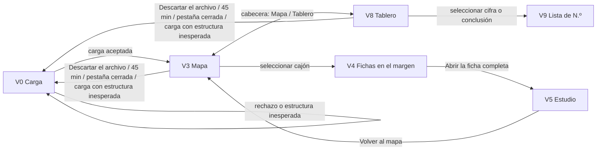

# Flujos de interfaz: EGM · Medios de vida

**Fecha**: 2026-11-21 · **Autor**: `disenador-front` · **Estado**: propuesta para revisión de Jairo

**Entradas**: `docs/specs/000-vision-alcance.md`, `001-lectura-verificacion/spec.md`, `002-mapa-interactivo/spec.md`,
`003-tablero-conclusiones/spec.md`, `contrato-datos.md` (apéndice A), `docs/arquitectura/arquitectura.md` (§5, §8),
ADR-003 y ADR-005, skill `sistema-diseno-egm` y sus referencias. Stack aceptado: FastAPI + Jinja2 + htmx, HTML y CSS
propios, sin framework de JavaScript.

**Entregables relacionados**: `docs/interfaz/tokens.css`, `docs/interfaz/bocetos/` (`index.html`, `carga.html`,
`mapa.html`, `estudio.html`, `tablero.html`, `colofon.html`, `boceto.css`, `boceto.js`).

Ningún flujo, boceto ni texto usa información interna del proyecto. Ninguna cifra viene de la lámina 7. Todas las cifras
son conteos que entrega el núcleo; la interfaz no calcula ningún conteo, solo dibuja el modelo de vista de
`app.presentacion` (M17).

---

## 1. Vistas y su correspondencia con la arquitectura

| Vista (arquitectura §8) | Boceto | Ruta lógica |
|---|---|---|
| V0 Inicio sin matriz, V1 Mensajes de carga y de sesión | `carga.html` | inicio, carga, descarte |
| Cabecera corrida | todas | — |
| V2 Avisos de lectura | `mapa.html`, `tablero.html` (bloque «Antes de leer los resultados») | — |
| V3 Mapa (cajonera), V4 Cajón abierto, V6 Definición, V7 Filtros, V10 Exportar | `mapa.html` | mapa, abrir cajón, definición, actualizar, restablecer, descargas |
| V5 Ficha de estudio | `estudio.html` | ficha de estudio por posición |
| V8 Tablero, V9 Lista de N.º | `tablero.html` | tablero, lista de una cifra |
| Colofón | `colofon.html` y pie de todas | — |

Recorrido general:

---

## 2. Estados comunes

Se definen una vez y cada flujo indica cuáles le aplican.

| Estado | Cuándo | Qué se ve (texto de interfaz) | Requisitos |
|---|---|---|---|
| **E1 Cargando** | Entre elegir el archivo y recibir la respuesta | «Leyendo la matriz. Esto puede tardar unos segundos.» (región de estado anunciada); el botón «Cargar la matriz» queda inactivo | US-001-4.1 |
| **E2 Rechazo por tipo** | Archivo que no es un libro .xlsx, o .xlsx dañado | «No se pudo cargar el archivo. El archivo elegido no es un archivo de Excel (.xlsx) que la herramienta pueda abrir, o está dañado. No se leyó y no se muestra ningún resultado. Elija la matriz bibliográfica en formato .xlsx.» | US-001-4.3, NFR-000-19, SC-000-19 |
| **E3 Rechazo por tamaño** | Más de 15 728 640 bytes | «No se pudo cargar el archivo. El archivo pesa más de 15 MB (15 728 640 bytes), el máximo que admite la herramienta. No se leyó y no se muestra ningún resultado de ese archivo.» | US-001-4.4, NFR-000-19, SC-000-19 |
| **E10 Rechazo por contenido** | Libro .xlsx dentro del límite de tamaño cuyo contenido descomprimido declarado supera el límite de NFR-000-19 | «No se pudo cargar el archivo. El contenido del libro es demasiado grande para abrirlo. No se leyó y no se muestra ningún resultado de ese archivo.» El mensaje no lleva cifras: ni el tamaño ni el límite | US-001-4.13, NFR-000-19, SC-000-19 |
| E2 / E3 / E10 con matriz previa | Igual, con una sesión abierta | Se agrega: «La matriz que tenía cargada sigue disponible con sus resultados: Matriz: <nombre>, leída el <fecha>, <n> documentos. Volver al mapa» | US-001-4.11, US-001-4.13, FR-001-29 |
| **E4 Estructura inesperada** (error de contrato) | Falta la hoja, un encabezado de rol, un delimitador del bloque de dimensiones, el valor ancla de estudio empírico, o la lista de intervenciones o de nivel | «No se pudo leer la matriz. Se esperaba <lo esperado>, y no se encontró / se encontraron: <lo encontrado>. No se muestra ninguna cifra. Revise que el archivo sea la matriz bibliográfica del proyecto y vuelva a cargarlo.» Nunca el nombre del archivo ni filas de datos | US-001-4.12, US-001-2.4, 2.5, 2.7, 2.9, 2.11, FR-001-02, FR-001-03, FR-001-23, FR-001-29 |
| E4 con matriz previa | Carga nueva con estructura inesperada | Título «No se pudo leer la matriz y la sesión terminó»; se agrega: «La herramienta borró todo: la matriz que tenía cargada y sus resultados ya no están disponibles. Para volver a verlos, cárguela otra vez.» | US-001-4.7, FR-001-29, NFR-000-17 |
| **E5 Sin estudios** | Matriz aceptada sin ningún estudio en el mapa | Mapa con todas las filas y columnas y el rótulo «ningún estudio registrado» en cada cajón; encima: «Todavía no hay estudios codificados en el mapa. Las filas y columnas son las de la matriz; cuando haya estudios empíricos con intervención y dimensiones marcadas, aparecerán aquí.» Tablero: cifras en 0 y cada conclusión dice que no hay casos y cuántos estudios se revisaron | casos borde de 002 y 003, FR-003-11 |
| E5 con filtros | Los filtros aplicados dejan 0 estudios | «Mostrando … : 0 de <N> estudios del mapa.»; cada cajón: «ningún estudio registrado con los filtros activos»; al margen: «Ningún estudio cumple estos filtros. Quite el filtro de <nombre> para ver más.» Conclusiones: «Ningún estudio cumple estos filtros.» | US-002-4.2, US-003-3.2, 3.3, FR-002-14, FR-003-15, FR-003-16 |
| **E6 Filtros sin aplicar** | La persona movió controles y no pulsó «Actualizar vista» | Mapa, tablero, cifras, notas y resumen siguen mostrando lo último aplicado. Texto fijo junto a los botones: «Los cambios en los filtros se aplican al pulsar «Actualizar vista». «Restablecer» quita todos los filtros de inmediato, en el mapa y en el tablero.» Al cambiar de vista, los controles se dibujan con lo último aplicado | US-002-4.10, US-003-5.4, FR-002-19 |
| **E7 Aviso de inactividad** | 43 minutos sin interacción | Aviso anunciado sobre la vista en curso: «Su sesión se cerrará en 2 minutos por falta de actividad. Al cerrarse, la matriz deja de estar disponible.» Botón «Seguir con la sesión» (cualquier interacción también cuenta) | NFR-000-04 (WCAG 2.2.1), NFR-000-17 |
| **E8 Sesión terminada** | Descarte, inactividad | Vista de carga con: «Descartó el archivo. La sesión terminó y la herramienta no guarda ninguna copia del archivo ni de sus resultados.» o «La sesión terminó porque pasaron 45 minutos sin actividad. La herramienta no guarda ninguna copia del archivo. Para seguir, cargue de nuevo la matriz.» | US-001-5.1, 5.3, FR-001-28 |
| **E9 Recarga** | La pestaña se recarga | «Recuperando su sesión.» Si vuelve en menos de 10 s, la sesión sigue con sus filtros aplicados; si no, vista de carga sin mensaje | NC-ADR003-2 (b), decisión de Jairo del 21-nov-2026 |

Reglas de texto en todos los estados: de usted, frase con mayúscula inicial, verbos concretos, sin «error de
contrato», «sesión efímera», «validación», «fixture» ni fórmulas (NFR-000-03, SC-000-03). Los mensajes de
rechazo y de estructura usan `role="alert"`; los de estado, `role="status"`. El foco pasa al título del mensaje.

---

## 3. Flujos del spec 001: lectura y verificación

### F-001-4 Cargar la matriz (US-001-4)

- **Vista**: V0 → V3. Boceto `carga.html`, luego `mapa.html`.
- **Acciones**: 1) La persona abre la herramienta y ve «Cargue la matriz bibliográfica», el texto sobre qué hace la
  herramienta, que el archivo solo se lee y vive en la pestaña, y el control «Archivo de la matriz (Excel .xlsx,
  hasta 15 MB)» con la ayuda «El límite exacto es 15 728 640 bytes». Ninguna cifra; el colofón dice «Datos. Aún no se
  ha cargado ninguna matriz.» 2) Elige el archivo y pulsa «Cargar la matriz». 3) E1. 4) Carga aceptada: se abre el
  mapa; la cabecera corrida dice «Matriz: matriz_bibliografica_estado_del_arte_v4.xlsx, leída el 21 de noviembre de
  2026, 27 documentos».
- **Carga de otro archivo**: «Cargar otro archivo» en la cabecera lleva al formulario de carga sin cerrar la sesión.
  Si la carga nueva se acepta (con o sin advertencias o notas), los resultados son solo del archivo nuevo y los
  filtros vuelven a «ningún filtro activo»; el resumen de filtros dice «Mostrando todos los estudios del mapa».
- **Estados**: E1, E2, E3 y E10 (con y sin matriz previa), E4 (con y sin matriz previa). Sin estudios: E5 tras la carga.
- **Cubre**: US-001-4.1 a 4.13; FR-001-19, FR-001-20, FR-001-29; NFR-000-01, NFR-000-12, NFR-000-17, NFR-000-19;
  SC-000-12, SC-000-19. US-001-4.6 (huella) no tiene interfaz: la garantiza la lectura en memoria.

### F-001-1 Ver el resultado de la lectura (US-001-1)

- **Vista**: cabecera corrida, V3 y V8. La historia es del núcleo; la interfaz solo muestra lo que el núcleo entrega.
- **Acciones**: tras la carga, la persona lee el nombre del archivo, la fecha de lectura y el número de documentos en
  la cabecera; en el tablero, las cifras clave (27 documentos, 7 estudios empíricos registrados, 1 estudio en el mapa,
  6 celdas con estudios, 42 sin ningún estudio registrado) y el estado de cada documento (6 empíricos que aún no entran
  al mapa). Cada celda en 1 abre su lista: N.º 7.
- **Estados**: E5 si no hay estudios del mapa. Una intervención o dimensión agregada en el archivo aparece como fila
  o columna sin cambios (US-001-1.3, 1.4).
- **Cubre**: US-001-1.1, 1.3, 1.4, 1.7, 1.9; FR-001-11, FR-001-13, FR-001-19; NFR-000-02, NFR-000-06, NFR-000-12.

### F-001-2 Recibir advertencias legibles (US-001-2)

- **Vista**: V2, bloque «Antes de leer los resultados», arriba del mapa y del tablero, antes de cualquier cifra.
- **Acciones**: la persona ve primero el resultado de la verificación (en negrita), luego un desplegable «<n>
  advertencias de lectura», luego las notas. Cada advertencia de fila dice N.º, columna y valor; las de archivo, hoja,
  columna o tabla dicen cuál. Ejemplo de la v4: «N.º 7, columna «Enfoque de género/diferencial», valor «…»: no
  empieza por Sí, No o Parcial, como pide la hoja Instrucciones. Queda como «Sin clasificar».» Pendientes: «6
  estudios empíricos aún no entran al mapa: N.º 10, 11, 13, 15, 16 y 24. Según la regla de la hoja Instrucciones, un
  estudio empírico entra al mapa cuando tiene la intervención y al menos una dimensión marcada.» Nota: «Columnas no
  usadas: Observaciones».
- **Estados**: sin advertencias, el desplegable no aparece; E4 para los errores de estructura (F-001-4).
- **Cubre**: US-001-2.1 a 2.16 (las de estructura, por E4); FR-001-10, FR-001-12, FR-001-18, FR-001-21, FR-001-24;
  SC-001-04.

### F-001-3 Ver el resultado de la verificación (US-001-3)

- **Vista**: V2 en el mapa y en el tablero (y en el tablero como cifra de confianza, F-003-4).
- **Textos**:
  - No verificable (v4): «No se pudieron contrastar los conteos con la hoja EGM del archivo, porque el archivo no
    trae guardados los resultados de esa hoja. Los conteos de esta herramienta se calculan directamente de la hoja
    «Matriz bibliográfica».» Sin lista de tablas verificadas.
  - Coincide: «Los conteos coinciden con la hoja EGM del archivo. Tablas verificadas: 1, 2 y 4.»
  - Difiere: «Los conteos difieren de la hoja EGM en la tabla <n>: <celdas>. Causa conocida: el N.º <k> tiene la misma
    intervención como principal y como secundaria; la hoja lo cuenta dos veces y esta herramienta, una.» Aparece antes
    de los resultados.
  - Solo se nombran las tablas comparables del contrato, por el número de su título.
- **Cubre**: US-001-3.1 a 3.17 en su presentación; FR-001-14, FR-001-16, FR-001-18, FR-001-25, FR-001-27;
  US-002-1.5, 1.6; US-003-4.4, 4.5.

### F-001-5 Terminar la sesión (US-001-5)

- **Vista**: cualquier vista con matriz → V0.
- **Acciones y estados**:
  - Descartar: botón «Descartar el archivo» en la cabecera corrida, siempre visible. Termina de inmediato, sin
    confirmación (volver a cargar es la forma de deshacer). E8.
  - Cerrar la pestaña: al volver a abrir la herramienta se ve V0, sin mensaje y sin cifras (US-001-5.2).
  - Inactividad: E7 a los 43 minutos; E8 a los 45. Cuentan como actividad el puntero (incluido pasar sobre una
    burbuja), el teclado, el toque, el foco y el desplazamiento (US-001-5.4 a 5.6).
  - Carga nueva con estructura inesperada: E4 con matriz previa.
  - Recargar la página: E9; no termina la sesión.
  - Texto fijo en la cabecera: «La sesión se cierra sola tras 45 minutos sin actividad. El archivo solo se lee: no se
    modifica ni se guarda.»
- **Cubre**: US-001-5.1 a 5.6; FR-001-28; NFR-000-17, NFR-000-18; SC-000-17.

---

## 4. Flujos del spec 002: mapa

### F-002-1 Ver el mapa (US-002-1)

- **Vista**: V3, `mapa.html`.
- **Disposición**: título «Mapa de evidencias»; texto breve de lectura; «Cómo leer el mapa» (pasos numerados,
  única secuencia real); V2; filtros y leyenda; frase de resumen; cajonera en 9 columnas con notas al margen en 3
  (≥ 1200 px); en pantallas angostas, una columna y la cajonera con desplazamiento lateral dentro de su recuadro y la
  columna de intervenciones fija.
- **Cajonera**: filas = intervenciones en el orden de la lista; columnas = dimensiones en el orden de la matriz. En cada
  cajón, una burbuja por nivel presente, ordenadas por la jerarquía, con radio $r \propto \sqrt{n}$ y el número escrito
  al lado. El radio llega como atributo del SVG desde M17 (no como estilo en línea, que la política de contenido de
  ADR-003 bloquea). Cajón vacío: contorno discontinuo y el texto «ningún estudio registrado». Con la v4: 6 filas, 8
  columnas, 6 cajones con 1 estudio de evaluación de impacto ({Transferencia de activos, Acompañamiento técnico} ×
  {Vulnerabilidad, Humano, Financiero}) y 42 con el rótulo.
- **Teclado** (patrón `grid` de WAI-ARIA): un solo Tab entra a la cajonera; flechas para moverse; Inicio y Fin en la
  fila; Ctrl+Inicio y Ctrl+Fin en la tabla; Intro o Espacio abren el cajón o la definición. Cada cajón tiene su
  etiqueta: «Acompañamiento técnico por Humano: 1 estudio, de evaluación de impacto»; «Transferencia de activos por
  Social: ningún estudio registrado».
- **Estados**: E5, E5 con filtros, avisos de verificación y advertencias (F-001-2, F-001-3).
- **Cubre**: US-002-1.1 a 1.7; FR-002-01 a FR-002-04, FR-002-17; NFR-000-04, 05, 08, 10; SC-002-01, SC-002-04,
  SC-000-08, SC-000-10.

### F-002-2 Ver los estudios de una celda (US-002-2)

- **Vista**: V4 en el margen del mapa; V5 `estudio.html`.
- **Acciones**: 1) La persona selecciona un cajón (clic o Intro). El cajón queda marcado con la línea roja de cabecera
  (único acento). 2) En el margen entra la ficha con el único movimiento del sistema (desplazamiento desde el margen,
  sin él si la persona pidió reducir el movimiento); el foco pasa al título del margen y se anuncia «Fichas de … abiertas
  en el margen». 3) El margen dice «1 estudio: N.º 7.» y muestra la ficha: N.º, referencia (enlace «Abrir la fuente» si
  contiene DOI o URL), año, nivel con su muestra y tipo de fuente. 4) «Abrir la ficha completa del N.º 7» lleva a V5 con
  los textos tal cual: país y población, dimensiones evaluadas, indicadores, hallazgos, vacío, limitaciones, aporte, y
  el enfoque con su categoría y su texto. 5) «Volver al mapa: Acompañamiento técnico por Humano» regresa con el mismo
  filtro y el mismo cajón seleccionado.
- **Cajón vacío**: el margen dice «Ningún estudio registrado. Nadie ha estudiado ese cruce o no se ha encontrado. Es
  una brecha provisional.» Con filtros activos: «Ningún estudio registrado con los filtros activos.» y nunca «brecha».
- **En móvil**: el margen se dibuja debajo de la cajonera; el foco salta a él.
- **Cubre**: US-002-2.1 a 2.4; FR-002-04 a FR-002-07; SC-002-02 (dos acciones: seleccionar el cajón y leer la
  referencia; abrir la fuente es la segunda); US-002-4.7; US-001-5.6.

### F-002-3 Consultar definiciones (US-002-3)

- **Vista**: V6, dentro del margen.
- **Acciones**: los nombres de filas y columnas son botones (subrayado punteado). Al activarlos, el margen muestra
  «<Nombre>. <texto del equipo, sin alteraciones>» o «Definición no disponible.» El mapa sigue funcionando.
- **Estados**: sin archivo de definiciones (caso actual): «Definición no disponible.» para todas.
- **Cubre**: US-002-3.1 a 3.3; FR-002-08.

### F-002-4 Filtrar el mapa (US-002-4)

- **Vista**: V7, bloque «Filtros y leyenda (ningún filtro activo | n filtros activos)», encima del mapa y del tablero.
- **Controles** (valores de las listas del archivo; sin lista, los valores presentes):
  - Tipo de fuente: casillas (Académica, Institucional, Territorial).
  - Metodología: casillas (las 7 de la lista).
  - Nivel de evidencia = leyenda del mapa: una casilla por nivel con su muestra (relleno y borde) y su cuenta en el mapa,
    más «Sin nivel». Con la v4: «Evaluación de impacto (1 estudio en el mapa)», «Estudio de caso (0…)», «Informe de
    proyecto (0…)», «Informe descriptivo/opinión (0…)», «Sin nivel (0 estudios en el mapa)», y la nota «En el tablero,
    «Sin nivel» incluye también los documentos que no son estudios empíricos.» Es un solo control: ocultar una entrada
    cambia la selección y espera a «Actualizar vista» como los demás.
  - Año: «Desde» y «Hasta», ambos incluidos, con los límites de la matriz (1992 y 2026).
  - Debajo, la muestra del cajón vacío con «Ningún estudio registrado: nadie ha estudiado ese cruce o no se ha
    encontrado. Es una brecha provisional.» (con filtros: «Ningún estudio registrado con los filtros activos.»).
- **Acciones**: 1) La persona marca o desmarca (E6: nada cambia). 2) Pulsa «Actualizar vista»: htmx reemplaza mapa,
  avisos, resumen y notas en una sola respuesta; el foco va a la frase de resumen, que se anuncia. 3) Resumen: «Mostrando
  solo fuentes territoriales: 0 de 1 estudios del mapa.» El bloque de filtros dice cuántos están activos y queda
  siempre visible. 4) «Restablecer» aplica de inmediato la vista sin filtros en mapa y tablero, y deja los controles
  sin filtros.
- **Regla de activo**: un control que no deja fuera ningún valor (todas las casillas marcadas, o el rango completo) no
  queda activo y no muestra «n de N» (US-002-4.13).
- **Estados**: E5 con filtros; E6.
- **Cubre**: US-002-4.1 a 4.14; FR-002-09 a FR-002-15, FR-002-18, FR-002-19; SC-002-03; US-001-5.5.

### F-002-5 Exportar (US-002-5)

- **Vista**: V10, sección «Descargar» bajo el mapa.
- **Acciones**: tres botones: «Descargar el mapa como imagen (PNG)», «Descargar el mapa como imagen vectorial (SVG)» y
  «Descargar los conteos (Excel)». Texto: «Los archivos muestran el mapa tal como lo ve ahora e indican los filtros
  activos, el nombre del archivo y la fecha de lectura.» La imagen lleva el mismo mapa (filas, columnas, burbujas,
  números, rótulos de cajón vacío o con filtros) y una cabecera con filtros, archivo y fecha. El libro .xlsx lleva esa
  misma nota en su cabecera y una tabla de conteos por cajón (con desglose por nivel). Nunca se escribe en la matriz
  cargada.
- **Estados**: con filtros activos, la descarga lleva lo aplicado, no las selecciones sin aplicar (E6). Mientras se
  prepara: «Preparando la descarga.»
- **Cubre**: US-002-5.1, 5.2; FR-002-16; NFR-000-09; SC-002-05. Decisión de Jairo: PNG con SVG adicional; conteos en
  .xlsx (NC-ADR003-1).

---

## 5. Flujos del spec 003: tablero

### F-003-1 Ver las cifras clave (US-003-1)

- **Vista**: V8 `tablero.html`, sección «Cifras clave».
- **Contenido** (v4): 27 documentos; 7 estudios empíricos registrados; 1 estudio en el mapa; 6 celdas con estudios, de
  48; 42 celdas sin ningún estudio registrado, de 48; 6 estudios empíricos que aún no entran al mapa. El total de
  celdas sale de las categorías del archivo.
- **Acciones**: cada cifra es un botón; al activarlo, el margen (V9) muestra su lista de N.º con su referencia
  («7 estudios empíricos registrados»: N.º 7, 10, 11, 13, 15, 16 y 24), y la frase «La lista tiene 7 N.º, igual que la
  cifra.» En móvil, la lista se despliega bajo la cifra.
- **Cubre**: US-003-1.1 a 1.5; FR-003-01, FR-003-02, FR-003-03, FR-003-21; NFR-000-02; SC-003-02, SC-000-02.

### F-003-2 Leer las conclusiones (US-003-2)

- **Vista**: V8, sección «Lo que dicen los datos», cada conclusión con su nota al margen (procedencia).
- **Textos** (plantillas; solo cambian los datos calculados):
  1. «42 de 48 cruces no tienen ningún estudio registrado en la matriz leída el 21 de noviembre de 2026. Son brechas
     provisionales: puede que nadie haya estudiado esos cruces o que el estudio aún no se haya encontrado.» Desplegable
     «Ver los 42 cruces». Nota: «Se revisó 1 estudio del mapa: N.º 7.»
  2. Sin casos (v4): «Ningún cruce está en esa situación: todos los cruces con estudios tienen al menos una evaluación
     de impacto. Se revisó 1 estudio del mapa.» Con casos: «<cruce>: 3 estudios, ninguno es evaluación de impacto; 2
     son estudios de caso y 1 es informe de proyecto.» No disponible: «No disponible: la lista de niveles de evidencia
     de esta matriz no incluye «Evaluación de impacto».»
  3. Tabla por intervención, sobre los estudios del mapa: estudios, lo incorporan, de forma parcial, no lo incorporan, sin clasificar y sin diligenciar (con sus N.º); la suma de las cinco da los estudios.
     v4: Transferencia de activos y Acompañamiento técnico, 1 estudio: 0, 0, 0, 1 (N.º 7), 0; las demás, «ningún estudio
     registrado». Aclaración sobre «Sin clasificar».
  4. «1 estudio analiza Acompañamiento técnico junto con Transferencia de activos.» «Vulnerabilidad, Humano y
     Financiero se miden juntas en 1 estudio.» Dimensiones que nunca se miden juntas, «solo sobre los estudios
     registrados en la matriz».
  5. «La matriz tiene 27 documentos. Ninguno es de fuente territorial y 20 no tienen el tipo de fuente diligenciado.
     Los años van de 1992 a 2026; el más reciente es de 2026.» Tablas de composición con «Sin diligenciar» visible y
     «año no reconocido» aparte.
  6. Por celda, desplegables con los textos tal cual de indicadores, vacío y limitaciones de cada estudio.
- **Acciones**: «Ver …» o la nota al margen abre la lista de N.º; su longitud coincide con el conteo (US-003-2.8).
- **Cubre**: US-003-2.1 a 2.10; FR-003-04 a FR-003-12, FR-003-22; SC-003-01, SC-003-05, SC-003-06.

### F-003-3 Filtrar el tablero (US-003-3)

- **Vista**: V8 con el mismo bloque V7 (mismo formulario, mismo estado de la sesión).
- **Acciones**: como F-002-4. Con filtro activo, cada cifra muestra «n de N» según su tipo (documentos sobre 27,
  estudios empíricos registrados sobre 7, estudios del mapa sobre 1, estudios empíricos que aún no entran al mapa sobre 6); conclusiones y listas se recalculan; ninguna dice «brecha»; una conclusión vacía dice
  «Ningún estudio cumple estos filtros.» En las cifras de documentos, un documento no empírico cuenta como «Sin nivel»
  (US-003-3.5); un estudio empírico que aún no entra al mapa y no tiene nivel no cuenta como «Sin nivel» y queda fuera mientras el filtro de nivel esté activo (NC-INT-2, §9).
- **Estados**: E5 con filtros, E6.
- **Cubre**: US-003-3.1 a 3.5; FR-003-13 a FR-003-16, FR-003-21; SC-003-03, SC-003-04.

### F-003-4 Confiar en lo que se lee (US-003-4)

- **Vista**: V8, aclaraciones bajo las cifras clave y V2.
- **Textos**: «Las 6 celdas con estudios provienen de 1 solo estudio, el N.º 7: un estudio puede ocupar varias
  celdas, y por eso los estudios no se suman por celdas.» «El mapa indica dónde hay evidencia y dónde falta. No dice qué
  ayuda funciona.» Resultado de la verificación como en F-001-3. Ningún porcentaje en ninguna vista.
- **Cubre**: US-003-4.1 a 4.5; FR-003-17 a FR-003-20; NFR-000-07; SC-000-07, SC-003-04.

### F-003-5 Recorrer el mapa y el tablero (US-003-5)

- **Vista**: navegación «Mapa | Tablero» en la cabecera corrida; la página actual se marca con el subrayado rojo.
- **Acciones**: los filtros aplicados viajan con la sesión: al pasar de una vista a otra, el mismo filtro sigue
  activo y los controles muestran lo último aplicado (las selecciones sin aplicar se pierden, E6). El tablero contiene
  cifras clave, mapa y conclusiones juntos; su cajonera se comporta como la del mapa. «Actualizar vista» y
  «Restablecer» son los mismos botones en ambas vistas.
- **Cubre**: US-003-5.1 a 5.5; FR-002-15, FR-002-19, FR-003-03, FR-003-13.

---

## 6. Colofón

- **Contenido por defecto** (boceto `colofon.html`): solo dos bloques.
  - «Datos. Matriz: <nombre del archivo tal como llegó>, leída el <fecha de la carga>, <n> documentos.» Sin matriz:
    «Datos. Aún no se ha cargado ninguna matriz.» Nunca una versión deducida del nombre.
  - «Referencia de diseño. International Initiative for Impact Evaluation (3ie). Building Peaceful Societies Evidence
    Gap Map (2019). Licencia CC BY-NC-SA 4.0. Se toma solo como referencia de diseño; no se reproduce su contenido.»
- Los nueve bloques configurables (proyecto, grupo, código Minciencias, semillero, equipo, herramienta, contacto y los
  dos logos) vienen apagados por defecto y no dejan rastro en el HTML (ADR-005, punto 2; decisión de Jairo del
  21-nov-2026, NC-INT-1). Cada uno se enciende por separado cuando Jairo tenga la autorización. Nada marcado como
  pendiente de confirmación se publica.
- **Cubre**: NFR-000-11 (con bloques apagados, ADR-005), NFR-000-12, NFR-000-16; SC-000-12, SC-000-16; US-001-4.2.

---

## 7. Decisiones de diseño y desviaciones justificadas

1. **Contorno del cajón vacío**: la skill pide contorno discontinuo en `--rayado`, que da 1.69:1 en claro y 1.49:1 en
   oscuro. Se agrega el token `--contorno-vacio` (3.20:1 y 4.10:1) para que el cajón vacío se distinga en escala de
   grises (SC-000-10). El concepto no cambia.
2. **Acento en oscuro**: `--cabecera` pasa de `#E0565D` (4.41:1) a `#EA6A70` (5.30:1), para que también sirva de texto.
   **Nivel 2 en oscuro**: relleno `#8AA0C2`, para separarlo del nivel 1 (1.63:1 → 2.24:1); el nivel se lee además
   por borde, número y leyenda.
3. **«Sin nivel»**: borde doble sin relleno, distinto del punteado del nivel 4 y del discontinuo del cajón vacío.
   Nivel nuevo del archivo: trama diagonal derivada, con advertencia de diseño (NFR-000-06).
4. **Aviso de inactividad (E7)**: WCAG 2.2.1 (nivel A, dentro de NFR-000-04) exige avisar antes de un límite de tiempo
   y permitir extenderlo. Los 45 minutos no cambian.
5. **Título**: «Evidencias sobre medios de vida» en la cabecera y «Mapa de evidencias» en la vista, sin «brechas», para
   que ningún texto fijo diga «brecha» con filtros activos (FR-002-14, SC-003-04). Decidido por Jairo el 21-nov-2026 (NC-INT-3, §9).
6. **Sin texto de «cambios sin aplicar» dinámico**: un texto fijo junto a «Actualizar vista» explica la regla; así no se
   agrega JavaScript que compare selecciones.
7. **Burbujas en SVG**: el radio va como atributo, porque la política de contenido sin estilos en línea (ADR-003) impide
   pasar el tamaño por `style`. La hoja definitiva tampoco puede fijar «8 columnas» a mano (los bocetos lo hacen): el
   ancho mínimo de la cajonera debe derivarse del número de dimensiones que entrega M17, por clase o por SVG.
8. **Ficha extensa**: en el detalle del estudio, el rayado de ficha se limita a la banda de cabecera, para que las líneas
   no crucen textos largos.
9. **Tipografías**: los bocetos no cargan Alegreya ni Alegreya Sans (ningún recurso externo); se ven con alternativas del
   sistema. La aplicación las sirve localmente (ADR-003).

---

## 8. Revisión de los bocetos

- Capturas a 1440 px y a 360 px (marco de 360 px reales), en claro y oscuro, de las cinco vistas. Hallazgos corregidos:
  cajonera más ancha que su columna a 1440 px; desbordes de la retícula, de la leyenda y del colofón a 360 px; botón
  principal sin relleno; entrada de la ficha con opacidad (texto atenuado durante la animación); lista de datos de la
  ficha en dos columnas estrechas a 360 px. A 360 px la página no se desplaza en horizontal; la cajonera se recorre
  dentro de su recuadro con la columna de intervenciones fija.
- Teclado: cada cajonera tiene un solo punto de entrada con Tab (foco itinerante comprobado en el DOM de `mapa.html` y
  `tablero.html`); flechas, Inicio, Fin e Intro según el patrón `grid`. La prueba completa solo con teclado y con
  lector de pantalla queda para el plan 002 con navegador automatizado (ADR-003, punto 8).
- Marcadores entre corchetes en cursiva: textos de la matriz que el apéndice A no trae (referencias completas, textos de
  las columnas E, K, T, U, V, W, X, Y, tipo de fuente y metodología del N.º 7). No se inventaron.

---

## 9. Puntos de la interfaz decididos por Jairo

Los cuatro puntos que la interfaz planteó como `[NEEDS CLARIFICATION]` quedaron decididos el 21-nov-2026
[Fuente: decisión de Jairo, 21-nov-2026]. Ninguno queda abierto.

- **NC-INT-1. Bloques visibles del colofón por defecto.** Hasta la autorización solo quedan visibles «Datos» y la
  referencia a 3ie; también se apagan por defecto «Proyecto», «Semillero» y «Equipo». Aplicado en ADR-005 (nota de
  revisión y punto 2) y en M21. Ver §6.
- **NC-INT-2. Estudios empíricos pendientes sin nivel en las cifras de documentos.** Siguen fuera de las cifras de
  documentos del tablero mientras el filtro de nivel esté activo; no se tratan como «Sin nivel». El spec no cambia:
  solo los documentos no empíricos se tratan como «Sin nivel» (FR-003-14). Los documentos «Sin tipo de documento
  válido» con el nivel vacío siguen también la regla general (COR-009). Aplicado en M06. Ver F-003-3.
- **NC-INT-3. Título de la cabecera.** «Evidencias sobre medios de vida», sin la palabra «brechas». El título de la
  vista, «Mapa de evidencias», es una decisión de diseño (§7, punto 5).
- **NC-INT-4. Exportación del mapa.** `app.exportacion` (M20) entrega el SVG y `app.cliente` (M19) lo convierte en PNG
  en el navegador (ADR-003, punto 7).
